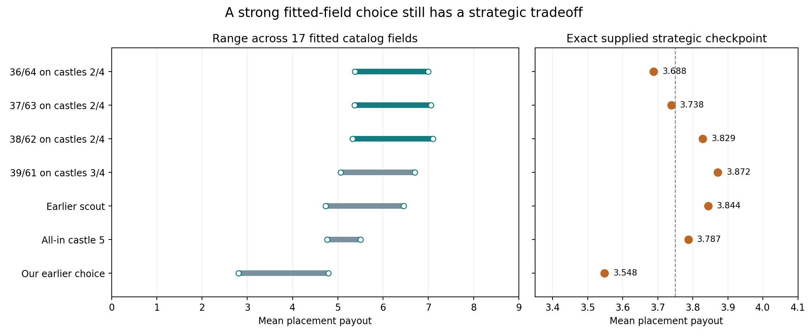
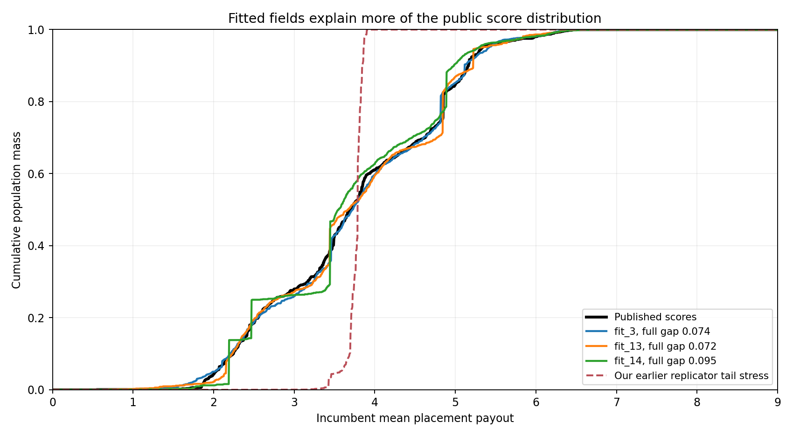
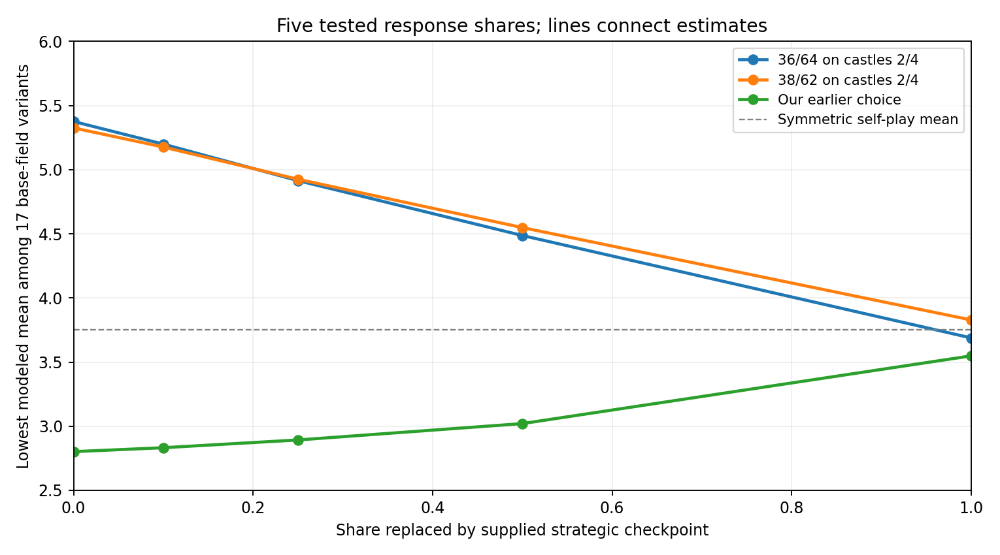

> Historical research checkpoint. Later recommendations supersede earlier choices. The final choice is in report 29. Statements about application submission describe the checkpoint date only.

**Game 2 cross-arena replay: 36/64 becomes the working lead**

I would now carry **(0,36,0,64,0)** forward as our leading Game 2 candidate. It wins the declared comparison on Parry's fitted population fields and clearly beats our earlier **(15,18,49,12,6)** there. Our earlier arenas remain useful stress tests, but their public-score mismatch means we should give their applicant predictions less weight.

This is a provisional working choice. **(0,38,0,62,0)** is the main nearby challenger because it gives up a little fitted-field performance for more strength against the supplied strategic checkpoint. No strategy has been submitted or locked. Game 1 remains **(3,8,4,44,41)**.

**What reproduced and what was tested**

The supplied original replay matched **all 68 available saved candidate-by-field results exactly**, including the original 36/64 range of 5.365043 to 6.992648. The original public-CDF validation also reproduced to floating-point precision. We used Python 3.13.5 and NumPy 2.4.4; the package records NumPy 2.5.4. This is verified numerical agreement with our actual environment, not a claim that we installed the recorded version.

Before new candidate evaluation, we froze **760 distinct legal allocations**: our previous 498, plus Parry's final-audit entries and strategic checkpoint candidates and remembered deviations. All seventeen retained fields then received **524,288 fresh opponent trios**, a total of 8,912,896 groups. Both engines agreed cell by cell for the named candidates on every group. All original 191 candidate sums also matched on all eighty-five old banks.

The primary comparison maximizes the lowest modeled expected 9/4/2/0 placement payout across the seventeen retained fields. The table's rank uses that rule within this 760-vector pool. A range spans different population hypotheses, not a confidence interval or individual-game outcomes. The strategic column integrates every iid triple from the supplied seventy-allocation checkpoint.

| Allocation, castles 1 through 5 | Rank / 760 | Range across 17 fitted fields | Strategic checkpoint |
|---|---:|---:|---:|
| `(0, 36, 0, 64, 0)` | 1 | 5.376 to 6.997 | 3.688 |
| `(0, 37, 0, 63, 0)` | 2 | 5.372 to 7.055 | 3.738 |
| `(0, 38, 0, 62, 0)` | 4 | 5.326 to 7.104 | 3.829 |
| `(0, 0, 39, 61, 0)` | 24 | 5.061 to 6.699 | 3.872 |
| `(0, 3, 35, 57, 5)` | 107 | 4.732 to 6.454 | 3.844 |
| `(0, 0, 0, 0, 100)` | 99 | 4.769 to 5.504 | 3.787 |
| `(15, 18, 49, 12, 6)` | 546 | 2.802 to 4.790 | 3.548 |

36/64 leads under all four declared rules: maximin over seventeen fields, maximin over the original nine stricter fields, and minimax regret on each set. The regret benchmark is the best of these 760 frozen candidates in each field, not a certified global best response.

It beats our earlier vector in **every one of the seventeen fields**, by **1.785 to 3.353 payout points**. This gap is far larger than numerical sampling error. Our earlier vector ranks 546th here; its old winning rank applied to our old populations and decision rule.

**How much trust to put in the population fits**

The original check compares incumbent-score CDFs at twenty-six selected thresholds. All seventeen fields pass that same screen again with independently sampled own allocations and opponent groups. A stricter check uses every CDF jump and a separate 181-point mean-gap grid. Thirteen fields pass on the original draws and fourteen on the fresh draws. The fresh full-curve failures are fit_9, fit_14, and fit_28.

These pass counts are diagnostics with own-action and opponent-sampling error. They are not formal identification of the hidden applicant population, confidence regions, or proof that a field failing one tolerance is impossible. The seventeen-field primary comparison stays unchanged. Descriptively removing the three fresh full-curve failures still leaves 36/64 as the leader.

This resolves the apparent inconsistency with our earlier review. We previously checked our arenas using the full curve, whereas Parry used twenty-six thresholds. Both checks now run on the same supplied fields, and those fields are substantially closer to the published score distribution than our previous arena models.

There is **no single inferred population percentage table**. The seventeen retained fits contain different forty-family weight vectors. They are alternative hypotheses, without assigned probabilities over fits. For example, the actual exact-all-in-five allocation share ranges from **0.00% to 9.58%** after counting its presence inside every family, not just the family named exact_allin5. Family labels can overlap in their allocations.

The [complete family shares](../lab/results/game2-cross-arena/review/population-family-shares.csv) list percentages in every field, plus descriptive minima, medians and maxima. A median across fits is a summary, not our estimated applicant share. The [CDF diagnostics](../lab/results/game2-cross-arena/review/public-cdf-diagnostics.csv) expose both screen definitions and every field's results. The original public snapshot is dated 2026-10-30T01:21:47Z, and its delivered copy contains scores only.

**What happens when opponents become more strategic**

We separately replaced 10%, 25%, and 50% of each of the seventeen base fields with Parry's saved strategic population, generating fifty-one new stress fields. These shifts are sensitivity tests, not fresh applicant forecasts, and were not refitted to the public CDF. 36/64 beats our earlier vector in all fifty-one, and also in the pure strategic checkpoint.

36/64's lowest payout among the fifty-one shifts is 4.487; its exact pure-checkpoint payout is 3.688. The checkpoint is approximate: its stored best-response allocation earns 4.025352, about 0.275 above 3.75. We reproduced that allocation's payoff, but did not repeat its full 4.6-million-action global search. This is not a certified Nash equilibrium.

The nearby 37/63 split has a fitted-field floor of 5.372 and checkpoint payout of 3.738. The 38/62 split has a fitted-field floor of 5.326 and checkpoint payout of 3.829. Thus, a preference for stronger performance against near-strategic opponents can reasonably change the last two troops. In an illustrative rule requiring at least 3.75 in every tested shift and the exact checkpoint, 38/62 is the best fitted-field choice in the frozen pool. That is an additional preference, not the primary rule or a guarantee outside those tested laws.

The connecting lines in the plot show tested shares only. We have not certified the full continuous share interval. We also retain the old stress losses: 36/64's old core/pressure/arena block means are 5.552, 3.852, and 3.787, versus 5.969, 5.561, and 4.180 for our earlier vector. Those constructed extremes did not disappear when the candidate changed.

**Why this allocation can work, and its limits**

Winning castles 2 and 4 outright secures six raw castle points. In these fitted populations, that often puts the entrant above several opponents who split their effort and points across other castles. The goal is placement payout, so six raw points can be very valuable without winning a majority of the fifteen castle points. This supports your broader idea of giving up castle 5, while the exact 2/4 split depends on opponent behavior. The per-field castle win and tie probabilities are saved in [the mechanism table](../lab/results/game2-cross-arena/review/castle-mechanism.json).

It still has a zero-payout counter: three copies of **(1,0,1,65,33)** leave 36/64 with only castle 2's two points, while each opponent gets 13/3 points. The fitted-field result is not a universal guarantee. Score-compatible models can also hide different underlying allocations, and changing the family catalog or within-family scout distribution may change the preferred entrant.

The simultaneous 95% sampling allowance is **+/-0.03188 points per candidate/field cell**, conditional on this frozen pool and these seventeen laws. This implies at most 0.06376 maximin shortfall relative to the best frozen candidate under those same laws. It does not cover model error or omitted allocations. The 36/64 versus 37/63 floor gap is only about 0.004, so the broad simultaneous bound does not certify a uniquely best split.

**What comes next**

The important remaining test is the population catalog itself: broaden scout amounts and target-split assumptions, remove influential families in turn, refit each variant against the same public-score evidence, and compare 36/64, 37/63, 38/62 and any independently discovered challengers. Freeze the resulting candidates before a fresh final comparison. More rounds against unchanged fitted fields would mostly reduce numerical error; they would not resolve this modeling uncertainty.

The replay and response-share verifiers passed, and all 110 unit tests passed. The prior recommendation files and previous studies remain intact. A small interrupted-run repair handled absent old-bank weights as numeric zero; the pre-repair freeze is preserved, and a verifier confirms that the candidate pool, seeds, populations, scorer and selection rule did not change.

All candidate rows are in [the comparison table](../lab/results/game2-cross-arena/candidate-comparison.csv). The reproducible code, source provenance, saved group banks, two verifiers and figures are in [the project](../lab/README.md). Run instructions are in the project README.
