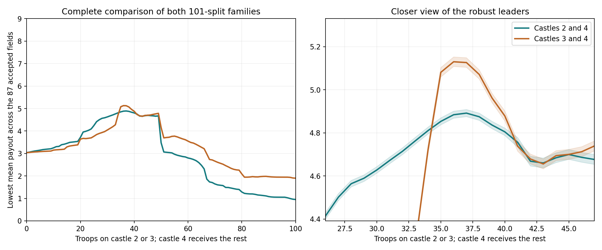
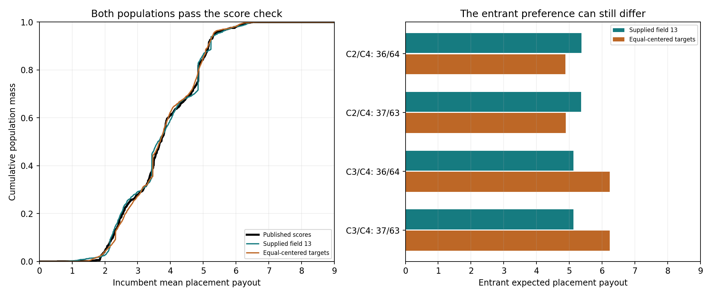
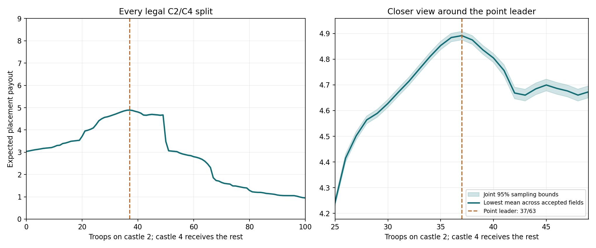
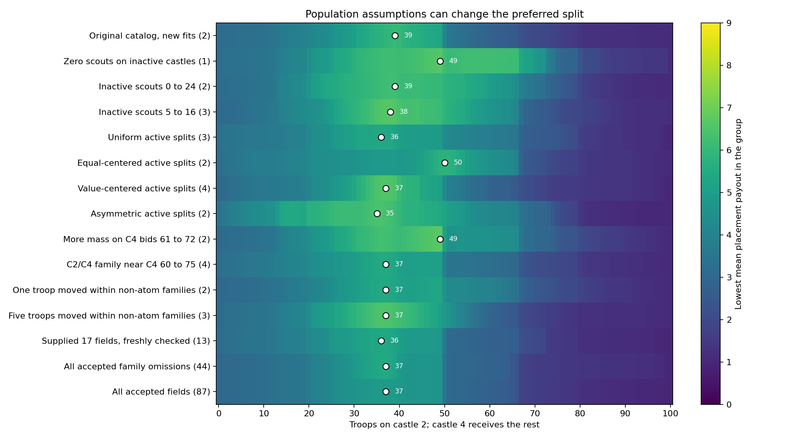
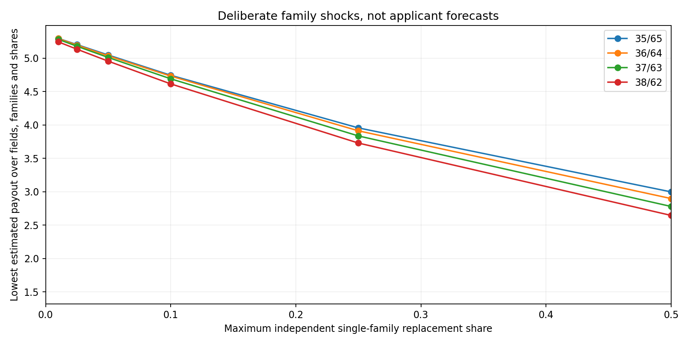

> Historical research checkpoint. Later recommendations supersede earlier choices. The final choice is in report 29. Statements about application submission describe the checkpoint date only.

**Game 2: family stress changes the leading castle pair**

The broader population test changes the working lead to **(0, 0, 36, 64, 0)**, targeting castles 3 and 4. Within the complete C2/C4 family, **(0,37,0,63,0)** is the point leader.

The new C3/C4 lead has a lowest modeled mean of **5.130 placement points** among the 87 accepted fields. The best C2/C4 floor is **4.891**. The floors for C2/C4 36/64 and 38/62 are **4.884** and **4.875**. These are conditional model results, not guarantees against actual applicants.

The complete 760-vector comparison, evaluated on 262,144 groups per field, selects **(0, 0, 36, 64, 0)**, with a lowest modeled mean of **5.137**. The 101 exact C2/C4 splits use **1,048,576 groups per field**. The all-760 comparison selects an allocation outside the exact C2/C4 family, so this study does not justify restricting the final submission to C2/C4. Comparisons across those two numerical precision levels should allow for sampling error.

That outside-family result triggered an equal-precision check of **every one of the 101 C3/C4 splits**, using the same million-group banks. All those allocations were already in the initial 760-vector freeze. The C3/C4 splits not excluded by sampling bounds have C3 = **[36, 37]**. The selected split's robust lower bound is 5.108; the largest robust upper bound for any frozen allocation outside C3/C4 is 4.942. This separates the selected C3/C4 allocation from every frozen non-C3/C4 allocation for the worst-population decision rule at joint 95% sampling confidence, conditional on these fields. It is not pointwise superiority in every field, a real-population guarantee, or a full-action optimum.

The change is driven by population assumptions. A field with more equal-centered active allocations still passes the public-score check but lowers the C2/C4 floor. The C3/C4 candidate retains a higher worst-field score. Adding that credible alternative changes the robust decision even though the original seventeen-field comparison favored C2/C4.

Two concrete examples show why the hidden allocations matter:

| Accepted population | Full-CDF gap | C2/C4 36/64 payout | C3/C4 36/64 payout |
|---|---:|---:|---:|
| supplied_fit_13 | 0.074 | 5.367 | 5.130 |
| equal_active_targets__unrestricted__2 | 0.055 | 4.884 | 6.237 |

Both match the public scores within our tolerance, but they prefer different entries. Their [full comparison table](../lab/results/game2-catalog-stress/review/two-compatible-populations.csv) contains the nearby splits too. A model's incumbent tail screen also does not cap a new entrant's predicted payout at the published leaderboard maximum.

The [two-family table](../lab/results/game2-catalog-stress/review/both-complete-split-families.csv) contains both complete curves and their bounds. The [full C3/C4 table](../lab/results/game2-catalog-stress/refinement/all-101-C3-C4-splits.csv) identifies its weakest field for every split.

**Coverage and what was held fixed**

The 760-vector pool was fixed before this stage and includes all 101 legal integer C2/C4 splits, including both extremes. We refitted twelve predefined catalog variants and all forty individual family omissions. This produced 145 frozen fitted/supplied models, of which 87 passed the new independent score-CDF screen. At least one model passed for 38 of the forty omissions. We tested every original family as a pure opponent population and as a replacement direction inside each of the seventeen supplied fields.

Across twelve catalogs, 480 family slots reduce to **268 distinct frozen pure-family laws** after deduplication. All 760 candidates were tested against each. The replacement study contains **1,360 conditional group banks**, covering one or two replaced opponents, with the zero- and three-replacement cases supplied separately. It tests all 101 exact splits plus six fixed outside-family references.

Every opponent vector remains a legal full joint allocation of 100 troops. No castle-marginal approximation or set of pairwise games replaces simultaneous four-player scoring. Every existing study and recommendation record is preserved.

**All 101 split results**

Rankings maximize the lowest mean across accepted fields. Model counts do not assign probabilities to population hypotheses. The interval is a joint sampling interval for the split's minimum across these fixed laws, not an uncertainty interval for the hidden real population.

| C2 / C4 troops | Lowest modeled mean | Highest modeled mean | Joint sampling bounds on the minimum |
|---|---:|---:|---:|
| 37 / 63 | 4.891 | 7.581 | 4.875 to 4.908 |
| 36 / 64 | 4.884 | 7.560 | 4.868 to 4.900 |
| 38 / 62 | 4.875 | 7.592 | 4.858 to 4.891 |
| 35 / 65 | 4.853 | 7.526 | 4.837 to 4.869 |
| 39 / 61 | 4.836 | 7.618 | 4.819 to 4.853 |
| 34 / 66 | 4.810 | 7.479 | 4.794 to 4.826 |
| 40 / 60 | 4.804 | 7.653 | 4.787 to 4.822 |
| 33 / 67 | 4.763 | 7.420 | 4.747 to 4.778 |

The [complete 101-row table](../lab/results/game2-catalog-stress/review/all-101-C2-C4-final-joint-bounds.csv) includes every allocation, its weakest field, and the final joint sampling bounds. The [split-by-field table](../lab/results/game2-catalog-stress/review/split-by-field.csv) shows each individual population rather than an invented weighted average.

The split values not excluded by the simultaneous sampling bounds are C2 = **[36, 37, 38]**, with C4 receiving the rest. The minimax-regret sensitivity rule selects **37/63**, measuring shortfall from the best exact split in each field. Across individual accepted fields, the best C2 point estimate ranges from 31 through 54. A single universally optimal split is not established.

**Which population assumptions change the result**

The modified target laws cover zero scouts, substantially wider scouts, uniform/equal/value-centered/asymmetric target bids, more mass near the castle-4 threshold, and small legal troop transfers. The five named exact point families remain intact. An omission removes one generator family, not every matching allocation that may also appear in another family.

| Population model group | Accepted / tested | Best split within that group |
|---|---:|---|
| Original catalog, new fits | 2 / 4 | 39 / 61, floor 6.037 |
| Zero scouts on inactive castles | 1 / 4 | 49 / 51, floor 6.631 |
| Inactive scouts 0 to 24 | 2 / 4 | 39 / 61, floor 6.246 |
| Inactive scouts 5 to 16 | 3 / 4 | 38 / 62, floor 6.617 |
| Uniform active splits | 3 / 4 | 36 / 64, floor 5.392 |
| Equal-centered active splits | 2 / 4 | 50 / 50, floor 5.796 |
| Value-centered active splits | 4 / 4 | 37 / 63, floor 6.544 |
| Asymmetric active splits | 2 / 4 | 35 / 65, floor 6.425 |
| More mass on C4 bids 61 to 72 | 2 / 4 | 49 / 51, floor 6.713 |
| C2/C4 family near C4 60 to 75 | 4 / 4 | 37 / 63, floor 5.503 |
| One troop moved within non-atom families | 2 / 4 | 37 / 63, floor 5.450 |
| Five troops moved within non-atom families | 3 / 4 | 37 / 63, floor 6.482 |
| Supplied 17 fields, freshly checked | 13 / 17 | 36 / 64, floor 5.367 |

The forty omission results are in [their full table](../lab/results/game2-catalog-stress/review/all-40-family-omissions.csv). No passing model was found for these omissions: balanced, heavy_five. That is a finite search outcome, not proof those families must occur. We keep optimizer statuses and failed validation results, rather than silently treating unsuccessful fits as impossible populations.

The field setting the selected split's floor is **equal_active_targets__unrestricted__2**, from catalog **equal_active_targets** under constraint **unrestricted**. Its full-CDF gap is 0.0549, with 181-grid mean gap 0.0057. The [complete family-weight table](../lab/results/game2-catalog-stress/review/all-model-family-shares.csv) lists all forty percentages in every tested model, with its acceptance flag. These are fitted hypotheses, not observed applicant shares or posterior probabilities.

The screen requires a full-CDF maximum gap at most 0.085, both mean-gap diagnostics at most 0.035, and no more than 0.015 modeled incumbent mass above the published maximum plus 0.2. Own-action sampling, opponent sampling, finite public reshuffles and the unobserved allocation catalog all limit interpretation. Multiple fits to the same public scores are not independent evidence that the underlying bids are correct.

**What a one-troop change actually does**

Every split used the same opponents within each model, and we saved all 101-by-101 payout cross-products. This lets us distinguish small paired numerical differences from changes caused by a different population.

For example, moving one troop from castle 4 to castle 2 can improve the castle-2 result against bids at the threshold while weakening the castle-4 result against its threshold bids. The final payout also depends on how the other three players divide the remaining castle points. We therefore measure higher and lower *placement payouts* directly.

The [payout-change table](../lab/results/game2-catalog-stress/review/split-payout-changes.csv) reports, for every split and accepted field, its probability of improving or hurting the payout relative to 36/64, the expected positive gain, the expected loss, and the net change. The [nearby paired intervals](../lab/results/game2-catalog-stress/review/nearby-paired-comparisons.csv) use the same complete groups.

Sampling bounds use a two-sided finite union of the empirical Bernstein bound in [Maurer and Pontil, Theorem 4](https://www.cs.mcgill.ca/~colt2009/papers/012.pdf). They account jointly for all 101 means and 5,050 unordered pairs in every retained field. Lower variance can give nearby split comparisons much narrower intervals than generic payoff-range bounds. They exclude population-model error and provide no full-action optimality certificate.

**Deliberate counterfamily stresses**

These tests remain separate from the public-score-compatible selection. Each opponent independently switches from a supplied base field to one chosen family. Conditional cases with zero, one, two or three replacements define a cubic in the replacement share. We check its endpoints and interior stationary points, so the point-estimate minima cover every share up to the stated limit, rather than just a handful of tested shares.

| Maximum replacement share | Best split | Its lowest estimated mean | 36/64 lowest mean |
|---|---:|---:|---:|
| 1% | 35/65 | 5.298 | 5.295 |
| 2.5% | 35/65 | 5.204 | 5.196 |
| 5% | 35/65 | 5.049 | 5.036 |
| 10% | 35/65 | 4.745 | 4.732 |
| 25% | 32/68 | 3.995 | 3.913 |
| 50% | 23/77 | 3.452 | 2.898 |
| 100% | 20/80 | 3.301 | 1.831 |

The low-share winners can be separated by only a few thousandths of a point, which is too small to treat as a firm change in strategy with these conditional sample sizes. Larger hostile shares show how the allocation can move substantially toward castle 4. These shares are hypothetical changes, not predicted applicant percentages. Conditional estimates and their cubic interpolation still have sampling error. Single-family replacement directions also do not exhaust simultaneous changes involving several different families.

The [forty-family stress table](../lab/results/game2-catalog-stress/review/all-40-family-stresses.csv) gives pure-family results and 10% replacement diagnostics. The [complete twelve-catalog pure-family table](../lab/results/game2-catalog-stress/review/all-catalog-pure-families.csv) contains all 101 split scores for every catalog/family slot, with shared laws explicitly identified.

The previous synthetic populations and adapting arenas also remain in the comparison. The [all-split prior-stress table](../lab/results/game2-catalog-stress/review/all-splits-prior-stress-banks.csv) reuses their independently verified eighty-five saved banks, with all 101 exact splits present in the old 760-vector score table. For 37/63, the old core/pressure/arena block means are 5.526, 3.829, and 3.754. These are retrospective stresses, not newly accepted applicant forecasts.

The new C3/C4 lead's old core/pressure/arena means are 4.960, 3.393, and 3.757. Its [complete C3/C4 prior-stress table](../lab/results/game2-catalog-stress/review/C3-C4-prior-stress-banks.csv) makes those tradeoffs visible too.

**What this establishes**

We have now tested every exact C2/C4 split across the declared family stresses and freshly checked population variants. We can choose a split under an explicit population model and quantify simulation error. The hidden applicant allocation distribution remains unknown, so neither this stage nor additional runs of the same models can establish a 100% real-world optimum.

There is also a concrete zero-payout counter to the new C3/C4 lead: three copies of **(1,1,0,65,33)** give **(0,0,36,64,0)** only three castle points while each opponent gets four. The entrant finishes last. The [exact rational check](../lab/results/game2-catalog-stress/review/new-lead-counterexample.json) records that outcome. The new recommendation is a model-conditional decision, not a universal security guarantee.

The decision is recorded as provisional in the new working record; earlier records remain intact. Game 1 remains **(3,8,4,44,41)**. No submission has been made. All three original audits, the C3/C4 refinement audit, and all 117 unit tests passed. The final confidence allocation covers the 760-vector prefix class, the predeclared C2/C4 class, and all 760 potential full-group means and pairs for the C3/C4 refinement. That last, wider class accounts for discovering the C3/C4 family from the pool. Reproduction commands and source/input hashes are in [the project](../lab/README.md).
