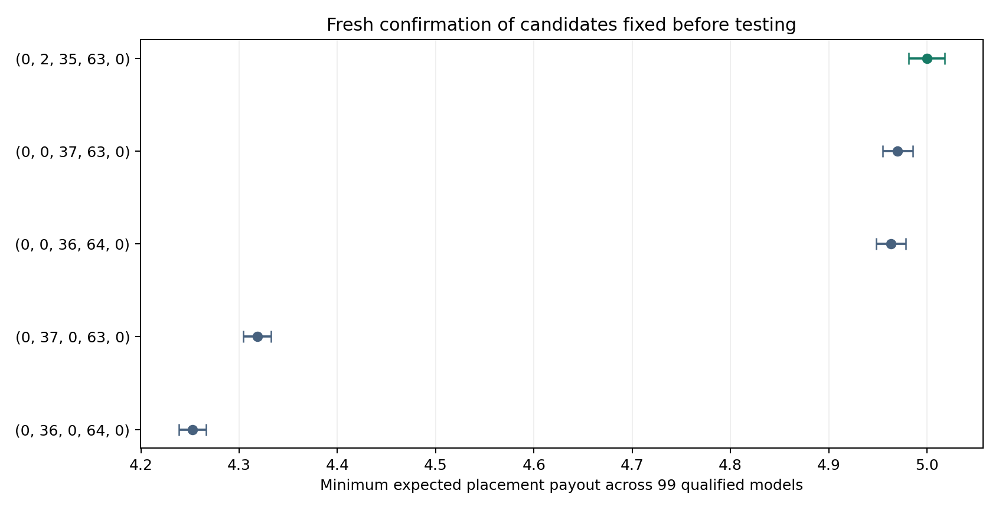
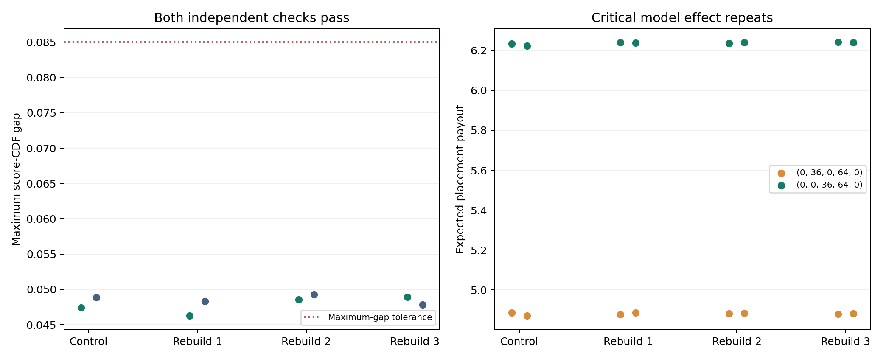

> Historical research checkpoint. Later recommendations supersede earlier choices. The final choice is in report 29. Statements about application submission describe the checkpoint date only.

**Game 2: independent replication and the complete allocation search**

The new choice is **(0, 2, 35, 63, 0)**. It won both complete-action discovery and the larger independent selection under our primary rule: maximize the minimum expected placement payout across the qualified population hypotheses. It also won when we retained all 87 old models alongside the new qualified ones. It was fixed before fresh confirmation, and no candidate was substituted afterward.

The two outstanding numerical checks from the previous audit are complete. We can use this as our model-based submission choice. Actual applicant frequencies remain unknown, so this does not establish the best allocation against the real field. Game 1 remains **(3, 8, 4, 44, 41)**. No application has been submitted.

**The influential population effect reproduced**

We rebuilt the equal-centered target-family catalog three times with independent seeds and 16,384 joint vectors per target family. Each retained the same family definitions. Transplanting the original influential weights isolates catalog-sampling sensitivity; twelve new fitting starts per catalog separately explored alternative weights. Retention used public incumbent-score fit and diversity, with no entrant payoff in its objective.

The original control and all three rebuilt anchors passed both fresh validation screens. Their older C3/C4 entry continued to outperform the older C2/C4 entry in every check:

| Fixed-weight population | Maximum CDF gap, two checks | C2/C4 payout | C3/C4 payout |
|---|---:|---:|---:|
| Control | 0.0474 to 0.0489 | 4.871 to 4.886 | 6.222 to 6.233 |
| Rebuild 1 | 0.0463 to 0.0483 | 4.878 to 4.885 | 6.239 to 6.240 |
| Rebuild 2 | 0.0486 to 0.0493 | 4.881 to 4.885 | 6.236 to 6.240 |
| Rebuild 3 | 0.0479 to 0.0489 | 4.880 to 4.881 | 6.240 to 6.241 |

The full screen scored every stored incumbent allocation at its actual catalog weight against 262,144 fresh opponent trios in each of two passes. This removes own-allocation sampling noise from the stored-law CDF; opponent sampling and uncertainty about human behavior remain. Of 110 unique frozen laws, 99 passed both checks: 81 of the old 87, 15 of 16 new refits, and three rebuilt anchors. The control anchor is already counted among the old models. Failed fields remain visible, and the old 87 are also compared without deleting their six newly failing fields.

These replications show that the earlier effect was reproducible within that population family. They are not independent observations that applicants actually follow it. The public score distribution still permits substantially different joint-bid populations.

**Every legal submission was searched**

We scored all **4,598,126** legal allocations against 65,536 discovery trios per field, then against a separate 524,288 selection trios per field. There were 109 evaluated fields, including reference fields outside the 99-model primary set. The candidate universe was fixed before scoring, and all exact C2/C4 and C3/C4 splits and every possible scout allocation are included.

For each opponent trio, the exact placement payout is a table of five lose/tie/win comparisons, preserving opponent identities and all castle/rank ties. Finite differences express it as signed threshold contributions. Five prefix passes on the budget simplex recover every action's integer sample score. This avoids billions of separate action-versus-trio calculations without replacing the joint game with castle marginals. The mathematical sample score is exact; its expectation is estimated from the draws.

**Fresh confirmation**

The selection phase fixed 22 comparison entries and the primary choice before 1,048,576 new trios per field. The following rows all use the same 99 qualified fields and new samples:

| Allocation | Minimum expected payout | Simultaneous numerical interval for the minimum |
|---|---:|---:|
| (0, 36, 0, 64, 0) | 4.2524 | 4.2385 to 4.2663 |
| (0, 37, 0, 63, 0) | 4.3185 | 4.3044 to 4.3326 |
| (0, 0, 36, 64, 0) | 4.9635 | 4.9484 to 4.9785 |
| (0, 0, 37, 63, 0) | 4.9700 | 4.9546 to 4.9853 |
| (0, 2, 35, 63, 0) | 4.9998 | 4.9815 to 5.0180 |

The selected entry's payouts range from **4.9998 to 7.2489** across those models. Its weakest confirmation field is `legacy__c24_threshold_family__unrestricted__3`. A floor difference compares two minima; it does not imply the selected allocation beats the other one in every model.

The new scout bid buys additional castle-2 wins and shares, funded by one fewer troop on each of castles 3 and 4. In `equal_rebuild_3__refit_0`, it raises placement payout by 0.051 even though average raw castle points fall slightly. In the selected entry's weakest threshold-family field, it instead costs 0.140 placement points relative to the old C3/C4 entry. The improvement is in the minimum across fields. The [scout mechanism table](../lab/results/game2-fullspace-search/scout-mechanism.json) records its actual castle-point changes and payout gains and losses. Adjacent scout splits remain close; the exact two-troop choice is the prespecified empirical winner, rather than a claim that every nearby split is statistically inferior. There are 4 frozen entries, including the selected entry, whose minimum-payoff intervals overlap the selected entry's lower bound.

**Changing the population assumptions still changes the choice**

Each row below reuses the complete-action selection under a rule fixed before testing. Payouts are from fresh confirmation on that row's own population set, so they should not be compared as if all rows used the same opponents.

| Population set | Complete-space selection winner | Confirmed minimum |
|---|---|---:|
| 99 qualified models | (0, 2, 35, 63, 0) | 5.000 |
| Previous 87 models | (0, 0, 36, 64, 0) | 5.122 |
| Union: 105 models | (0, 2, 35, 63, 0) | 5.000 |
| Original 17 models | (0, 36, 0, 64, 0) | 5.372 |
| 79 qualified, excluding equal-centered | (0, 36, 0, 64, 0) | 5.372 |

The pure C3/C4 entry remains the winner on the previous 87. The new scout improves protection against the broader refits. Removing every equal-centered law returns the C2/C4 choice, as does keeping only the original 17. Numerical replication substantially reduces the concern about an accidental catalog draw, while preserving the substantive uncertainty about this family of human behavior.

A post-selection removal diagnostic, using the saved complete-action selection scores, retained the exact two-scout choice after **97 of 99** individual model deletions. Removing `equal_rebuild_3__refit_0` restores (0, 0, 36, 64, 0); removing `legacy__supplied_fit_27` instead favors (0, 2, 47, 51, 0). The exact scout refinement is therefore model-sensitive too. Removing both deliberately targeted catalog variants together leaves (0, 2, 35, 63, 0) as the complete-space winner. The [117 removal diagnostics](../lab/results/game2-fullspace-search/model-removal-diagnostics.csv) are retrospective sensitivity evidence, with no new holdout or change to the frozen candidate choice.

We did not assign a percentage chance to each model. A model is an alternative complete population hypothesis. Taking the minimum makes duplicates irrelevant, but adding a genuinely new adverse plausible law can change the result. The [family-weight table](../lab/results/game2-fullspace-search/model-family-weights.csv) gives all forty conditional family percentages for every law; those are model assumptions, not measured applicant shares. The complete-space minimax-regret choice is (0, 0, 37, 63, 0), reflecting a different objective from our chosen maximin rule.

**Numerical confidence and limits**

Half of the 5% numerical error budget covers every action and field in the complete selection scan with a Hoeffding union bound. The other half covers the fixed confirmation panel's means and paired comparisons with empirical Bernstein bounds. Conditional on the frozen laws, the joint calculation bounds the selected entry's maximin shortfall from the best of all legal allocations by **0.0746 placement-payout points**, at at least 95% confidence. The complete-space selection error allowance is 0.0434; the selected minimum's confirmation interval is 4.9815 to 5.0180.

This bound includes action search uncertainty. It excludes error in the population assumptions, which more simulation from the same generators cannot remove. Score-CDF tolerances are diagnostic acceptance rules, not probabilities that a model is true. Earlier adapting arenas remain separate stress evidence and are preserved.

**Validation and saved evidence**

All 122 tests passed, including exhaustive reduced-budget checks, full-budget indexing and direct-score comparisons. Independent acceptance regenerated every catalog and opponent bank, checked all CDF decisions, reconstructed every complete-action objective, checked representative whole-space entries against direct lookup and the independent foundation scorer on all groups, and verified the confirmation moments and confidence calculations. The audits document exactly which score cells were checked; they do not claim a second cell-by-cell replay of the complete action-by-trio Cartesian product.

The [protocol](../lab/GAME2-REPLICATION-SEARCH-PROTOCOL.md), [confirmation results](../lab/results/game2-fullspace-search/confirmation-results.json), [all candidate/model scores](../lab/results/game2-fullspace-search/confirmation-by-field.csv), [population-subset comparisons](../lab/results/game2-fullspace-search/confirmation-by-rule.csv) and [versioned working record](../lab/results/game2-working-candidate-v4.json) preserve the decision. Earlier freezes, source inputs, results and recommendations remain unchanged. The prior two requested numerical tasks are finished; another numerical stage is not required before using this conditional choice.
